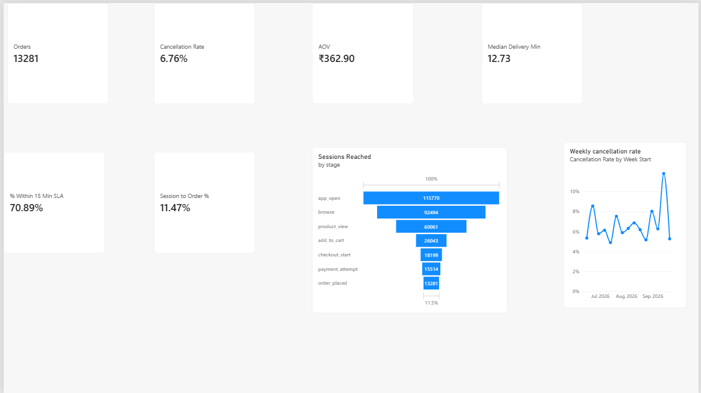
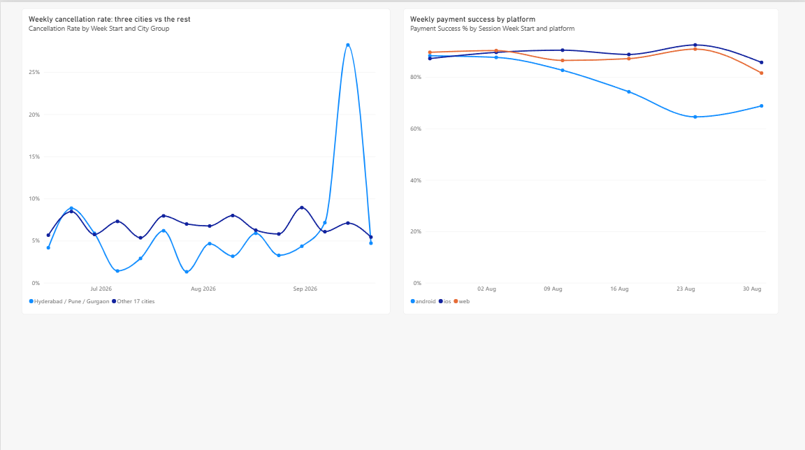

# Quick-Commerce Order Analytics

A Product Analyst portfolio project. I simulated a quick-commerce company with a 10 to 15 minute delivery promise, built its database and data myself, and investigated three problems in it: a payment failure on one platform, a one-week cancellation spike, and higher cancellations in cities with small store networks.

**The data is synthetic.** I generated it with a seeded script and planted the patterns on purpose, so this project shows how I find and explain patterns, not discoveries about a real company. The planted patterns are listed below.




## What is in the data

| Table | Rows | What it holds |
|---|---|---|
| `cities` | 20 | City, store count, HRA class |
| `users` | 4,000 | Signup date, home city, signup channel |
| `sessions` | 115,770 | One row per app visit: user, city, time, platform |
| `session_events` | 341,362 | One row per funnel stage a session reached (7 stages) |
| `orders` | 13,281 | Orders created by sessions that completed payment, with delivery time or cancellation reason |

Funnel stages: app open, browse, product view, add to cart, checkout start, payment attempt, order placed.

## Key results

| Metric | Value |
|---|---|
| Orders | 13,281 |
| Cancellation rate | 6.76% |
| Average order value (delivered orders) | ₹362.90 |
| Median delivery time | 12.73 minutes |
| Delivered within the 15-minute promise | 70.89% |
| Sessions that end in an order | 11.47% |

Findings (all tested in `docs/statistics.md`):
1. **Android payments dropped after Aug 15.** Payment success fell from 88.0% to 68.4% on Android. iOS did not change (88.1% to 88.9%). About 400 orders were lost.
2. **Cancellations spiked in one week in three cities.** In Hyderabad, Pune and Gurgaon, 28.2% of orders were cancelled in the week of Sep 14, against 4.7% in their other weeks. 87.5% of those cancellations were out of stock. The company-wide weekly rate only moved from 6.3% to 11.8%, so the spike is easy to miss without splitting by city.
3. **Small store networks cancel more.** Cities with fewer than 40 stores cancel 11.7% of orders, against 5.0% for cities with 75 or more stores.
4. **City class looks like a driver but is not.** Class Y cities cancel more than class X cities (9.7% vs 5.5%), but the gap disappears once store network size is held fixed. This is confounding.

Full write-up: `docs/insights_report.md`.

## The patterns I planted

- Cancellations depend on store network size (small networks cancel more and are slower).
- Hyderabad, Pune and Gurgaon get an out-of-stock cancellation spike from 14 to 20 Sep 2026.
- Android payment success drops after 15 Aug 2026.
- Referral users add to cart more often. Evening hours are slower.
- Order volume per city is proportional to store count (an assumption).

## Project structure

```
sql/01_schema.sql          schema, city data, derived city view
sql/02_data_checks.sql     integrity checks (each returns zero rows)
sql/03_metrics.sql         core metrics, slices, findings, supporting queries
scripts/generate_data.py   seeded data generator (rebuilds all rows)
scripts/stats_tests.py     significance tests and confidence intervals
dashboard/                 Power BI file, PDF export and page screenshots
docs/statistics.md         statistical checks
docs/insights_report.md    findings and recommendations
docs/sources.md            where each input came from
```

## How to reproduce

1. Install PostgreSQL and Python. Then `pip install -r requirements.txt`.
2. Create the database: `psql -U postgres -c "CREATE DATABASE qcommerce_v2;"`
3. Create `scripts/db_config.py` (it is not committed, because it holds a password):
   ```python
   DB_CONFIG = {"host": "localhost", "port": 5432, "dbname": "qcommerce_v2",
                "user": "postgres", "password": "YOUR_PASSWORD"}
   ```
4. Build the schema: `psql -U postgres -d qcommerce_v2 -f sql/01_schema.sql`
5. Generate the data: `python scripts/generate_data.py` (seed 42, so you get the same data every time)
6. Run the queries in `sql/` and the tests: `python scripts/stats_tests.py`

## Sources and assumptions

- **City list and store counts** are copied from a published city-wise store-count list and treated as approximate. Exact citation and access date are in `docs/sources.md`. It is a third-party source, not company data.
- **Store bands** (Large 75+ stores, Mid 40 to 74, Small under 40) use cutoffs I chose. The band is derived in SQL, not stored.
- **HRA class (X/Y)** is the government's population-based classification for house rent allowance. It is not a delivery-infrastructure measure, and no single official "tier" list exists.
- Everything else (users, sessions, orders, times, amounts, cancellations) is generated, and the rates in the generator are my own assumptions.

## Limitations

- Because I planted the patterns, the tests recover what I put in.
- The spike week was chosen after looking at the data, so its p-value is optimistic.
- The tests treat orders as independent, but one user can place several orders.
- The funnel has 7 stages, where a real company would track more detail.